# Documento de evidencias de pruebas · Ciclo 1 (C1)

> **Control del documento** · Versión 1.0 · 13/11/2026 · Responsable: Yanimar Burbano Piamba (líder de QA) · Estado: Vigente · Cambios: «Historial del documento» al final y `docs/gestion/CONTROL-DE-CAMBIOS.md`

**ASEGURAMIENTO DE LA CALIDAD** · Quién lo tiene — Liberación 1.0

Responsables de QA: Yanimar Burbano Piamba · Francisco José Castro Muñoz
Sesiones de ejecución: 2026-11-12 (corte del Sprint 1: suite automatizada y sesión exploratoria de la interfaz). Se completa con las sesiones del Sprint 2 al cierre del ciclo (15/11).

## 1. Introducción

Este documento reúne la evidencia de los 30 casos del Sprint 1 y de los 8 casos no funcionales del ciclo C1, ejecutados el 12/11/2026 sobre la versión v0.2.0. Todos los casos del Sprint 1 están automatizados con JUnit 5, así que la evidencia es la salida de `./mvnw verify`, los reportes de Surefire y Failsafe y una captura por módulo con cada caso y sus pruebas. Se organiza por módulo; cada caso tiene su ficha. Los 23 casos del Sprint 2 se agregarán al cierre del ciclo.

**Ambiente y versiones**

| Momento | Versión / commit | Uso |
|---|---|---|
| Sesión 1 — 2026-11-12 | v0.2.0 · `ea7351d` | Ambiente de QA (Linux, Java 21.0.12, Docker 29.9 con Testcontainers `postgis/postgis:17-3.5-alpine`): unitarias, integración y cobertura |
| CI run #83 — 2026-11-12 | v0.2.0 · `ea7351d` | GitHub Actions: build, pruebas, SpotBugs/FindSecBugs, Trivy y Gitleaks |

**Resumen**

| Resultado | Casos | Prioridad Alta |
|---|---|---|
| Aprobado | 38 (30 funcionales y de seguridad + 8 no funcionales) | 28 |
| Fallido | 0 | 0 |
| Bloqueado | 0 | 0 |
| No ejecutado | 23 (historias del Sprint 2) | 23 |

## 2. Evidencia de la suite automatizada

| Evidencia | Archivo |
|---|---|
| Salida de `./mvnw verify` (resumen Surefire/Failsafe) | [`mvn-verify.txt`](../../evidencias/C1/2026-11-12/mvn-verify.txt) · reportes por clase en [`reportes-junit/`](../../evidencias/C1/2026-11-12/reportes-junit/) |
| Resumen de la suite y cobertura por módulo | 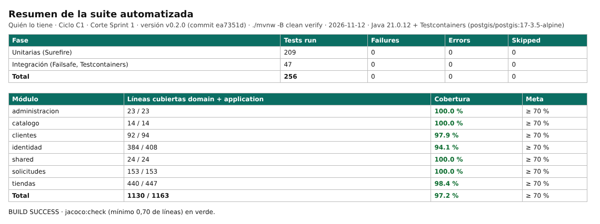 |
| Resumen de cobertura JaCoCo | [`jacoco.csv`](../../evidencias/C1/2026-11-12/jacoco.csv) · 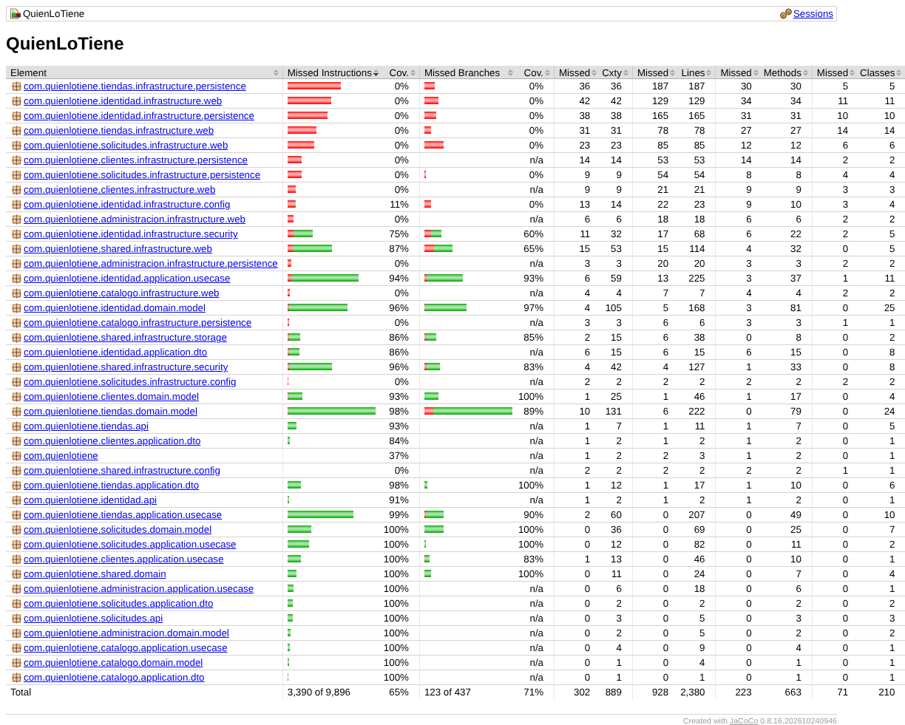 |
| Ejecución en GitHub Actions | [CI run #83](https://github.com/Daniel0442123/QuienLoTiene/actions/runs/43297877152) |
| Escaneos (SpotBugs, Trivy, Gitleaks) | [`ci-seguridad-run83.txt`](../../evidencias/C1/2026-11-12/ci-seguridad-run83.txt) |

## 3. Módulo identidad (Francisco Castro y Yanimar Burbano) — sesión 2026-11-12

Captura de la sesión: 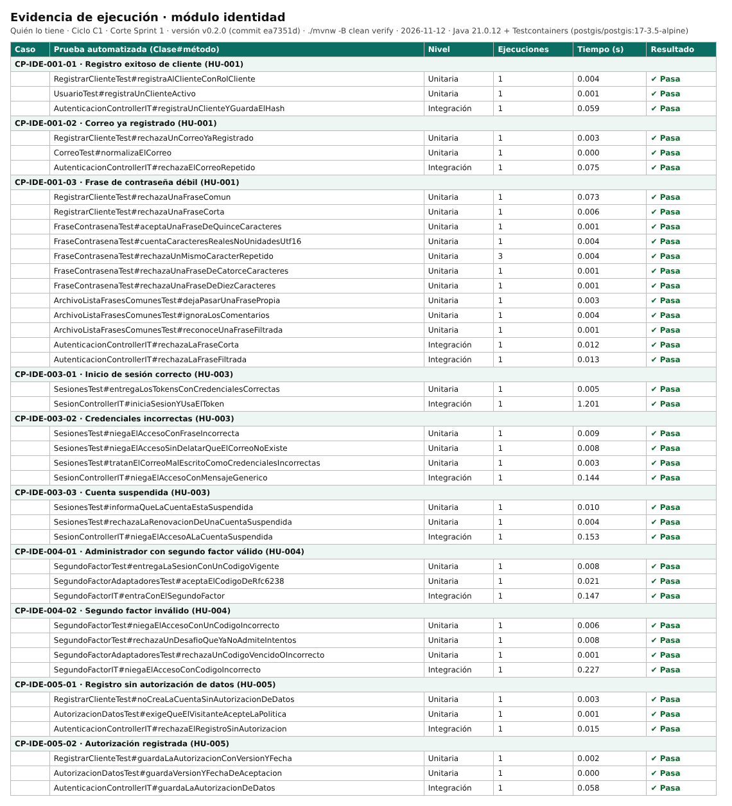

### 3.1 CP-IDE-001-01 — Registro exitoso de cliente

| Campo | Valor |
|---|---|
| Requisito / criterio | RF-001 · CP-001 del SRS · HU-001 |
| Tipo / nivel / prioridad | Funcional · Unitaria · Alta |
| Prueba automatizada | `RegistrarClienteTest#registraAlClienteConRolCliente` `UsuarioTest#registraUnClienteActivo` `AutenticacionControllerIT#registraUnClienteYGuardaElHash` |
| Precondición y datos | No existe una cuenta con el correo "ana@correo.com" La visitante aceptó la política de tratamiento de datos |
| Pasos ejecutados | `./mvnw -B clean verify` sobre v0.2.0; las pruebas reproducen: 1. Se registra con una frase de contraseña de 20 caracteres |
| Resultado esperado | El sistema crea la cuenta con rol CLIENTE |
| Resultado obtenido | 3 de 3 pruebas en verde (3 ejecuciones, 0.06 s); se cumple el resultado esperado. |
| Probador | Yanimar Burbano |
| Resultado | Aprobado |
| Defecto | — |
| Evidencia |  · `../../evidencias/C1/2026-11-12/reportes-junit/` |

### 3.2 CP-IDE-001-02 — Correo ya registrado

| Campo | Valor |
|---|---|
| Requisito / criterio | RF-001 · CP-002 del SRS · HU-001 |
| Tipo / nivel / prioridad | Funcional · Unitaria · Alta |
| Prueba automatizada | `RegistrarClienteTest#rechazaUnCorreoYaRegistrado` `CorreoTest#normalizaElCorreo` `AutenticacionControllerIT#rechazaElCorreoRepetido` |
| Precondición y datos | Existe una cuenta con el correo "ana@correo.com" |
| Pasos ejecutados | `./mvnw -B clean verify` sobre v0.2.0; las pruebas reproducen: 1. Alguien intenta registrarse con ese correo |
| Resultado esperado | El sistema rechaza el registro e indica que el correo ya está en uso |
| Resultado obtenido | 3 de 3 pruebas en verde (3 ejecuciones, 0.08 s); se cumple el resultado esperado. |
| Probador | Yanimar Burbano |
| Resultado | Aprobado |
| Defecto | — |
| Evidencia |  · `../../evidencias/C1/2026-11-12/reportes-junit/` |

### 3.3 CP-IDE-001-03 — Frase de contraseña débil

| Campo | Valor |
|---|---|
| Requisito / criterio | RF-001 · CP-003 del SRS · HU-001 |
| Tipo / nivel / prioridad | Seguridad · Unitaria · Alta |
| Prueba automatizada | `RegistrarClienteTest#rechazaUnaFraseComun` `RegistrarClienteTest#rechazaUnaFraseCorta` `FraseContrasenaTest#aceptaUnaFraseDeQuinceCaracteres` `FraseContrasenaTest#cuentaCaracteresRealesNoUnidadesUtf16` `FraseContrasenaTest#rechazaUnMismoCaracterRepetido` `FraseContrasenaTest#rechazaUnaFraseDeCatorceCaracteres` `FraseContrasenaTest#rechazaUnaFraseDeDiezCaracteres` `ArchivoListaFrasesComunesTest#dejaPasarUnaFrasePropia` `ArchivoListaFrasesComunesTest#ignoraLosComentarios` `ArchivoListaFrasesComunesTest#reconoceUnaFraseFiltrada` `AutenticacionControllerIT#rechazaLaFraseCorta` `AutenticacionControllerIT#rechazaLaFraseFiltrada` |
| Precondición y datos | — |
| Pasos ejecutados | `./mvnw -B clean verify` sobre v0.2.0; las pruebas reproducen: 1. Un visitante se registra con una frase de 10 caracteres o con una contraseña filtrada conocida |
| Resultado esperado | El sistema rechaza el registro y explica el requisito de longitud |
| Resultado obtenido | 12 de 12 pruebas en verde (14 ejecuciones, 0.12 s); se cumple el resultado esperado. |
| Probador | Francisco Castro |
| Resultado | Aprobado |
| Defecto | — |
| Evidencia |  · `../../evidencias/C1/2026-11-12/reportes-junit/` |

### 3.4 CP-IDE-003-01 — Inicio de sesión correcto

| Campo | Valor |
|---|---|
| Requisito / criterio | RF-003 · CP-006 del SRS · HU-003 |
| Tipo / nivel / prioridad | Seguridad · Integración (API + Spring Security) · Alta |
| Prueba automatizada | `SesionesTest#entregaLosTokensConCredencialesCorrectas` `SesionControllerIT#iniciaSesionYUsaElToken` |
| Precondición y datos | Un cliente con cuenta activa |
| Pasos ejecutados | `./mvnw -B clean verify` sobre v0.2.0; las pruebas reproducen: 1. Inicia sesión con su correo y su frase de contraseña |
| Resultado esperado | Recibe un token de acceso de 15 minutos y una cookie de refresco HttpOnly |
| Resultado obtenido | 2 de 2 pruebas en verde (2 ejecuciones, 1.21 s); se cumple el resultado esperado. |
| Probador | Francisco Castro |
| Resultado | Aprobado |
| Defecto | — |
| Evidencia |  · `../../evidencias/C1/2026-11-12/reportes-junit/` |

### 3.5 CP-IDE-003-02 — Credenciales incorrectas

| Campo | Valor |
|---|---|
| Requisito / criterio | RF-003 · CP-007 del SRS · HU-003 |
| Tipo / nivel / prioridad | Seguridad · Unitaria · Alta |
| Prueba automatizada | `SesionesTest#niegaElAccesoConFraseIncorrecta` `SesionesTest#niegaElAccesoSinDelatarQueElCorreoNoExiste` `SesionesTest#tratanElCorreoMalEscritoComoCredencialesIncorrectas` `SesionControllerIT#niegaElAccesoConMensajeGenerico` |
| Precondición y datos | — |
| Pasos ejecutados | `./mvnw -B clean verify` sobre v0.2.0; las pruebas reproducen: 1. Un usuario inicia sesión con una frase de contraseña incorrecta |
| Resultado esperado | El sistema niega el acceso con un mensaje genérico |
| Resultado obtenido | 4 de 4 pruebas en verde (4 ejecuciones, 0.16 s); se cumple el resultado esperado. |
| Probador | Francisco Castro |
| Resultado | Aprobado |
| Defecto | — |
| Evidencia |  · `../../evidencias/C1/2026-11-12/reportes-junit/` |

### 3.6 CP-IDE-003-03 — Cuenta suspendida

| Campo | Valor |
|---|---|
| Requisito / criterio | RF-003 · CP-008 del SRS · HU-003 |
| Tipo / nivel / prioridad | Seguridad · Unitaria · Alta |
| Prueba automatizada | `SesionesTest#informaQueLaCuentaEstaSuspendida` `SesionesTest#rechazaLaRenovacionDeUnaCuentaSuspendida` `SesionControllerIT#niegaElAccesoALaCuentaSuspendida` |
| Precondición y datos | Una tienda suspendida por el administrador |
| Pasos ejecutados | `./mvnw -B clean verify` sobre v0.2.0; las pruebas reproducen: 1. Intenta iniciar sesión con credenciales correctas |
| Resultado esperado | El sistema niega el acceso e informa que la cuenta está suspendida |
| Resultado obtenido | 3 de 3 pruebas en verde (3 ejecuciones, 0.17 s); se cumple el resultado esperado. |
| Probador | Francisco Castro |
| Resultado | Aprobado |
| Defecto | — |
| Evidencia |  · `../../evidencias/C1/2026-11-12/reportes-junit/` |

### 3.7 CP-IDE-004-01 — Administrador con segundo factor válido

| Campo | Valor |
|---|---|
| Requisito / criterio | RF-004 · CP-009 del SRS · HU-004 |
| Tipo / nivel / prioridad | Seguridad · Unitaria · Media |
| Prueba automatizada | `SegundoFactorTest#entregaLaSesionConUnCodigoVigente` `SegundoFactorAdaptadoresTest#aceptaElCodigoDeRfc6238` `SegundoFactorIT#entraConElSegundoFactor` |
| Precondición y datos | Un administrador con TOTP configurado que ingresó su contraseña |
| Pasos ejecutados | `./mvnw -B clean verify` sobre v0.2.0; las pruebas reproducen: 1. Ingresa un código TOTP vigente |
| Resultado esperado | Accede al panel de administración |
| Resultado obtenido | 3 de 3 pruebas en verde (3 ejecuciones, 0.18 s); se cumple el resultado esperado. |
| Probador | Francisco Castro |
| Resultado | Aprobado |
| Defecto | — |
| Evidencia |  · `../../evidencias/C1/2026-11-12/reportes-junit/` |

### 3.8 CP-IDE-004-02 — Segundo factor inválido

| Campo | Valor |
|---|---|
| Requisito / criterio | RF-004 · CP-010 del SRS · HU-004 |
| Tipo / nivel / prioridad | Seguridad · Unitaria · Media |
| Prueba automatizada | `SegundoFactorTest#niegaElAccesoConUnCodigoIncorrecto` `SegundoFactorTest#rechazaUnDesafioQueYaNoAdmiteIntentos` `SegundoFactorAdaptadoresTest#rechazaUnCodigoVencidoOIncorrecto` `SegundoFactorIT#niegaElAccesoConCodigoIncorrecto` |
| Precondición y datos | — |
| Pasos ejecutados | `./mvnw -B clean verify` sobre v0.2.0; las pruebas reproducen: 1. El administrador ingresa un código TOTP vencido o incorrecto |
| Resultado esperado | El sistema niega el acceso al panel |
| Resultado obtenido | 4 de 4 pruebas en verde (4 ejecuciones, 0.24 s); se cumple el resultado esperado. |
| Probador | Francisco Castro |
| Resultado | Aprobado |
| Defecto | — |
| Evidencia |  · `../../evidencias/C1/2026-11-12/reportes-junit/` |

### 3.9 CP-IDE-005-01 — Registro sin autorización de datos

| Campo | Valor |
|---|---|
| Requisito / criterio | RF-005 · CP-011 del SRS · HU-005 |
| Tipo / nivel / prioridad | Seguridad · Unitaria · Alta |
| Prueba automatizada | `RegistrarClienteTest#noCreaLaCuentaSinAutorizacionDeDatos` `AutorizacionDatosTest#exigeQueElVisitanteAcepteLaPolitica` `AutenticacionControllerIT#rechazaElRegistroSinAutorizacion` |
| Precondición y datos | — |
| Pasos ejecutados | `./mvnw -B clean verify` sobre v0.2.0; las pruebas reproducen: 1. Un visitante envía el registro sin marcar la casilla de autorización |
| Resultado esperado | El sistema no crea la cuenta y resalta la casilla |
| Resultado obtenido | 3 de 3 pruebas en verde (3 ejecuciones, 0.02 s); se cumple el resultado esperado. |
| Probador | Francisco Castro |
| Resultado | Aprobado |
| Defecto | — |
| Evidencia |  · `../../evidencias/C1/2026-11-12/reportes-junit/` |

### 3.10 CP-IDE-005-02 — Autorización registrada

| Campo | Valor |
|---|---|
| Requisito / criterio | RF-005 · CP-012 del SRS · HU-005 |
| Tipo / nivel / prioridad | Seguridad · Unitaria · Alta |
| Prueba automatizada | `RegistrarClienteTest#guardaLaAutorizacionConVersionYFecha` `AutorizacionDatosTest#guardaVersionYFechaDeAceptacion` `AutenticacionControllerIT#guardaLaAutorizacionDeDatos` |
| Precondición y datos | — |
| Pasos ejecutados | `./mvnw -B clean verify` sobre v0.2.0; las pruebas reproducen: 1. Un visitante se registra aceptando la política versión 1.0 |
| Resultado esperado | El sistema guarda la autorización con fecha, hora y versión 1.0 |
| Resultado obtenido | 3 de 3 pruebas en verde (3 ejecuciones, 0.06 s); se cumple el resultado esperado. |
| Probador | Francisco Castro |
| Resultado | Aprobado |
| Defecto | — |
| Evidencia |  · `../../evidencias/C1/2026-11-12/reportes-junit/` |

## 4. Módulo clientes (Yanimar Burbano) — sesión 2026-11-12

Captura de la sesión: 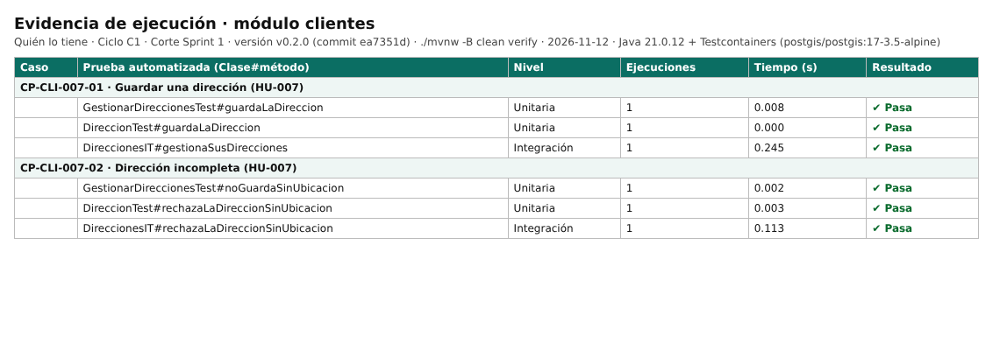

### 4.1 CP-CLI-007-01 — Guardar una dirección

| Campo | Valor |
|---|---|
| Requisito / criterio | RF-007 · CP-015 del SRS · HU-007 |
| Tipo / nivel / prioridad | Funcional · Unitaria · Alta |
| Prueba automatizada | `GestionarDireccionesTest#guardaLaDireccion` `DireccionTest#guardaLaDireccion` `DireccionesIT#gestionaSusDirecciones` |
| Precondición y datos | El cliente está autenticado |
| Pasos ejecutados | `./mvnw -B clean verify` sobre v0.2.0; las pruebas reproducen: 1. Guarda la dirección "Casa" con pin en el mapa, dirección escrita, indicaciones y teléfono |
| Resultado esperado | La dirección aparece disponible al pedir domicilio |
| Resultado obtenido | 3 de 3 pruebas en verde (3 ejecuciones, 0.25 s); se cumple el resultado esperado. |
| Probador | Yanimar Burbano |
| Resultado | Aprobado |
| Defecto | — |
| Evidencia |  · `../../evidencias/C1/2026-11-12/reportes-junit/` |

### 4.2 CP-CLI-007-02 — Dirección incompleta

| Campo | Valor |
|---|---|
| Requisito / criterio | RF-007 · CP-016 del SRS · HU-007 |
| Tipo / nivel / prioridad | Funcional · Unitaria · Alta |
| Prueba automatizada | `GestionarDireccionesTest#noGuardaSinUbicacion` `DireccionTest#rechazaLaDireccionSinUbicacion` `DireccionesIT#rechazaLaDireccionSinUbicacion` |
| Precondición y datos | — |
| Pasos ejecutados | `./mvnw -B clean verify` sobre v0.2.0; las pruebas reproducen: 1. El cliente intenta guardar una dirección sin ubicación en el mapa |
| Resultado esperado | El sistema la rechaza e indica el dato faltante |
| Resultado obtenido | 3 de 3 pruebas en verde (3 ejecuciones, 0.12 s); se cumple el resultado esperado. |
| Probador | Yanimar Burbano |
| Resultado | Aprobado |
| Defecto | — |
| Evidencia |  · `../../evidencias/C1/2026-11-12/reportes-junit/` |

## 5. Módulo tiendas (Yanimar Burbano) — sesión 2026-11-12

Captura de la sesión: 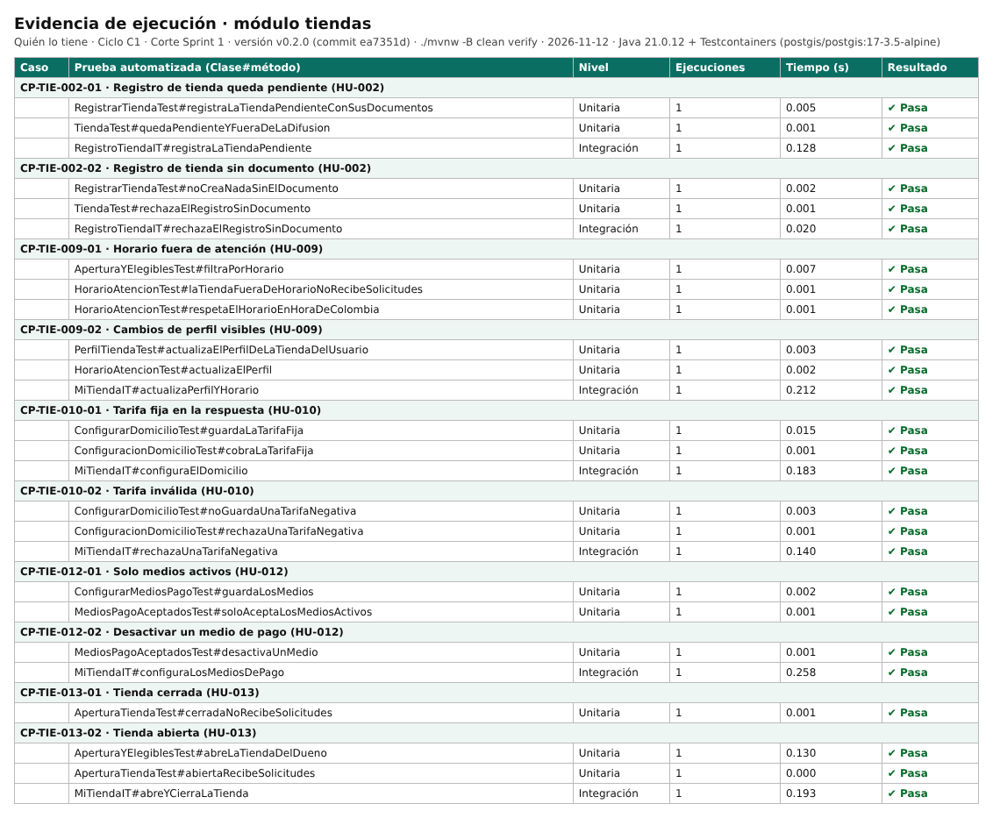

### 5.1 CP-TIE-002-01 — Registro de tienda queda pendiente

| Campo | Valor |
|---|---|
| Requisito / criterio | RF-002 · CP-004 del SRS · HU-002 |
| Tipo / nivel / prioridad | Funcional · Unitaria · Alta |
| Prueba automatizada | `RegistrarTiendaTest#registraLaTiendaPendienteConSusDocumentos` `TiendaTest#quedaPendienteYFueraDeLaDifusion` `RegistroTiendaIT#registraLaTiendaPendiente` |
| Precondición y datos | — |
| Pasos ejecutados | `./mvnw -B clean verify` sobre v0.2.0; las pruebas reproducen: 1. Un dueño registra su tienda con todos los datos, la foto del local y el RUT |
| Resultado esperado | La tienda queda en estado Pendiente No aparece en la difusión de solicitudes |
| Resultado obtenido | 3 de 3 pruebas en verde (3 ejecuciones, 0.13 s); se cumple el resultado esperado. |
| Probador | Yanimar Burbano |
| Resultado | Aprobado |
| Defecto | — |
| Evidencia |  · `../../evidencias/C1/2026-11-12/reportes-junit/` |

### 5.2 CP-TIE-002-02 — Registro de tienda sin documento

| Campo | Valor |
|---|---|
| Requisito / criterio | RF-002 · CP-005 del SRS · HU-002 |
| Tipo / nivel / prioridad | Funcional · Unitaria · Alta |
| Prueba automatizada | `RegistrarTiendaTest#noCreaNadaSinElDocumento` `TiendaTest#rechazaElRegistroSinDocumento` `RegistroTiendaIT#rechazaElRegistroSinDocumento` |
| Precondición y datos | — |
| Pasos ejecutados | `./mvnw -B clean verify` sobre v0.2.0; las pruebas reproducen: 1. Un dueño intenta registrar su tienda sin adjuntar el documento de existencia |
| Resultado esperado | El sistema rechaza el registro e indica el campo faltante |
| Resultado obtenido | 3 de 3 pruebas en verde (3 ejecuciones, 0.02 s); se cumple el resultado esperado. |
| Probador | Yanimar Burbano |
| Resultado | Aprobado |
| Defecto | — |
| Evidencia |  · `../../evidencias/C1/2026-11-12/reportes-junit/` |

### 5.3 CP-TIE-009-01 — Horario fuera de atención

| Campo | Valor |
|---|---|
| Requisito / criterio | RF-009 · CP-019 del SRS · HU-009 |
| Tipo / nivel / prioridad | Funcional · Unitaria · Alta |
| Prueba automatizada | `AperturaYElegiblesTest#filtraPorHorario` `HorarioAtencionTest#laTiendaFueraDeHorarioNoRecibeSolicitudes` `HorarioAtencionTest#respetaElHorarioEnHoraDeColombia` |
| Precondición y datos | Una tienda aprobada y abierta con horario de 8:00 a 18:00 |
| Pasos ejecutados | `./mvnw -B clean verify` sobre v0.2.0; las pruebas reproducen: 1. Un cliente publica una solicitud a las 19:00 |
| Resultado esperado | La tienda no la recibe |
| Resultado obtenido | 3 de 3 pruebas en verde (3 ejecuciones, 0.01 s); se cumple el resultado esperado. |
| Probador | Yanimar Burbano |
| Resultado | Aprobado |
| Defecto | — |
| Evidencia |  · `../../evidencias/C1/2026-11-12/reportes-junit/` |

### 5.4 CP-TIE-009-02 — Cambios de perfil visibles

| Campo | Valor |
|---|---|
| Requisito / criterio | RF-009 · CP-020 del SRS · HU-009 |
| Tipo / nivel / prioridad | Funcional · Unitaria · Alta |
| Prueba automatizada | `PerfilTiendaTest#actualizaElPerfilDeLaTiendaDelUsuario` `HorarioAtencionTest#actualizaElPerfil` `MiTiendaIT#actualizaPerfilYHorario` |
| Precondición y datos | — |
| Pasos ejecutados | `./mvnw -B clean verify` sobre v0.2.0; las pruebas reproducen: 1. La tienda actualiza su teléfono y sus fotos |
| Resultado esperado | El cliente ve los datos nuevos en el detalle de la tienda |
| Resultado obtenido | 3 de 3 pruebas en verde (3 ejecuciones, 0.22 s); se cumple en el dominio y los casos de uso (la regla queda guardada y aplicada); la vista del cliente depende de HU-014 (Sprint 3) y se re-prueba de punta a punta en C2/C3. |
| Probador | Yanimar Burbano |
| Resultado | Aprobado |
| Defecto | — |
| Evidencia |  · `../../evidencias/C1/2026-11-12/reportes-junit/` |

### 5.5 CP-TIE-010-01 — Tarifa fija en la respuesta

| Campo | Valor |
|---|---|
| Requisito / criterio | RF-010 · CP-021 del SRS · HU-010 |
| Tipo / nivel / prioridad | Funcional · Unitaria · Alta |
| Prueba automatizada | `ConfigurarDomicilioTest#guardaLaTarifaFija` `ConfiguracionDomicilioTest#cobraLaTarifaFija` `MiTiendaIT#configuraElDomicilio` |
| Precondición y datos | Una tienda con domicilio y tarifa fija de 5.000 COP |
| Pasos ejecutados | `./mvnw -B clean verify` sobre v0.2.0; las pruebas reproducen: 1. Responde Sí lo tengo a una solicitud con domicilio |
| Resultado esperado | El cliente ve un costo de domicilio de 5.000 COP en la tarjeta |
| Resultado obtenido | 3 de 3 pruebas en verde (3 ejecuciones, 0.20 s); se cumple en el dominio y los casos de uso (la regla queda guardada y aplicada); la tarjeta de respuesta depende de HU-019 (Sprint 2) y se re-prueba de punta a punta en C2/C3. |
| Probador | Yanimar Burbano |
| Resultado | Aprobado |
| Defecto | — |
| Evidencia |  · `../../evidencias/C1/2026-11-12/reportes-junit/` |

### 5.6 CP-TIE-010-02 — Tarifa inválida

| Campo | Valor |
|---|---|
| Requisito / criterio | RF-010 · CP-022 del SRS · HU-010 |
| Tipo / nivel / prioridad | Funcional · Unitaria · Alta |
| Prueba automatizada | `ConfigurarDomicilioTest#noGuardaUnaTarifaNegativa` `ConfiguracionDomicilioTest#rechazaUnaTarifaNegativa` `MiTiendaIT#rechazaUnaTarifaNegativa` |
| Precondición y datos | — |
| Pasos ejecutados | `./mvnw -B clean verify` sobre v0.2.0; las pruebas reproducen: 1. La tienda intenta guardar una tarifa negativa |
| Resultado esperado | El sistema rechaza el valor |
| Resultado obtenido | 3 de 3 pruebas en verde (3 ejecuciones, 0.14 s); se cumple el resultado esperado. |
| Probador | Yanimar Burbano |
| Resultado | Aprobado |
| Defecto | — |
| Evidencia |  · `../../evidencias/C1/2026-11-12/reportes-junit/` |

### 5.7 CP-TIE-012-01 — Solo medios activos

| Campo | Valor |
|---|---|
| Requisito / criterio | RF-012 · CP-025 del SRS · HU-012 |
| Tipo / nivel / prioridad | Funcional · Unitaria · Alta |
| Prueba automatizada | `ConfigurarMediosPagoTest#guardaLosMedios` `MediosPagoAceptadosTest#soloAceptaLosMediosActivos` |
| Precondición y datos | Una tienda que acepta solo efectivo y transferencia |
| Pasos ejecutados | `./mvnw -B clean verify` sobre v0.2.0; las pruebas reproducen: 1. El cliente confirma una orden con esa tienda |
| Resultado esperado | Solo puede elegir efectivo o transferencia |
| Resultado obtenido | 2 de 2 pruebas en verde (2 ejecuciones, 0.00 s); se cumple en el dominio y los casos de uso (la regla queda guardada y aplicada); la elección en la orden depende de HU-024 (Sprint 2) y se re-prueba de punta a punta en C2/C3. |
| Probador | Yanimar Burbano |
| Resultado | Aprobado |
| Defecto | — |
| Evidencia |  · `../../evidencias/C1/2026-11-12/reportes-junit/` |

### 5.8 CP-TIE-012-02 — Desactivar un medio de pago

| Campo | Valor |
|---|---|
| Requisito / criterio | RF-012 · CP-026 del SRS · HU-012 |
| Tipo / nivel / prioridad | Funcional · Unitaria · Alta |
| Prueba automatizada | `MediosPagoAceptadosTest#desactivaUnMedio` `MiTiendaIT#configuraLosMediosDePago` |
| Precondición y datos | — |
| Pasos ejecutados | `./mvnw -B clean verify` sobre v0.2.0; las pruebas reproducen: 1. La tienda desactiva el datáfono |
| Resultado esperado | El datáfono deja de aparecer en las órdenes nuevas |
| Resultado obtenido | 2 de 2 pruebas en verde (2 ejecuciones, 0.26 s); se cumple en el dominio y los casos de uso (la regla queda guardada y aplicada); las órdenes nuevas dependen de HU-024 (Sprint 2) y se re-prueba de punta a punta en C2/C3. |
| Probador | Yanimar Burbano |
| Resultado | Aprobado |
| Defecto | — |
| Evidencia |  · `../../evidencias/C1/2026-11-12/reportes-junit/` |

### 5.9 CP-TIE-013-01 — Tienda cerrada

| Campo | Valor |
|---|---|
| Requisito / criterio | RF-013 · CP-027 del SRS · HU-013 |
| Tipo / nivel / prioridad | Funcional · Unitaria · Alta |
| Prueba automatizada | `AperturaTiendaTest#cerradaNoRecibeSolicitudes` |
| Precondición y datos | Una tienda con el interruptor en Cerrado |
| Pasos ejecutados | `./mvnw -B clean verify` sobre v0.2.0; las pruebas reproducen: 1. Un cliente cercano publica una solicitud de su categoría |
| Resultado esperado | La tienda no la recibe |
| Resultado obtenido | 1 de 1 pruebas en verde (1 ejecuciones, 0.00 s); se cumple el resultado esperado. |
| Probador | Yanimar Burbano |
| Resultado | Aprobado |
| Defecto | — |
| Evidencia |  · `../../evidencias/C1/2026-11-12/reportes-junit/` |

### 5.10 CP-TIE-013-02 — Tienda abierta

| Campo | Valor |
|---|---|
| Requisito / criterio | RF-013 · CP-028 del SRS · HU-013 |
| Tipo / nivel / prioridad | Funcional · Unitaria · Alta |
| Prueba automatizada | `AperturaYElegiblesTest#abreLaTiendaDelDueno` `AperturaTiendaTest#abiertaRecibeSolicitudes` `MiTiendaIT#abreYCierraLaTienda` |
| Precondición y datos | Una tienda con el interruptor en Abierto y dentro de su horario |
| Pasos ejecutados | `./mvnw -B clean verify` sobre v0.2.0; las pruebas reproducen: 1. Un cliente a 1 km publica una solicitud de su categoría |
| Resultado esperado | La tienda la recibe en su panel |
| Resultado obtenido | 3 de 3 pruebas en verde (3 ejecuciones, 0.32 s); se cumple el resultado esperado. |
| Probador | Yanimar Burbano |
| Resultado | Aprobado |
| Defecto | — |
| Evidencia |  · `../../evidencias/C1/2026-11-12/reportes-junit/` |

## 6. Módulo solicitudes (Yanimar Burbano y Francisco Castro) — sesión 2026-11-12

Captura de la sesión: 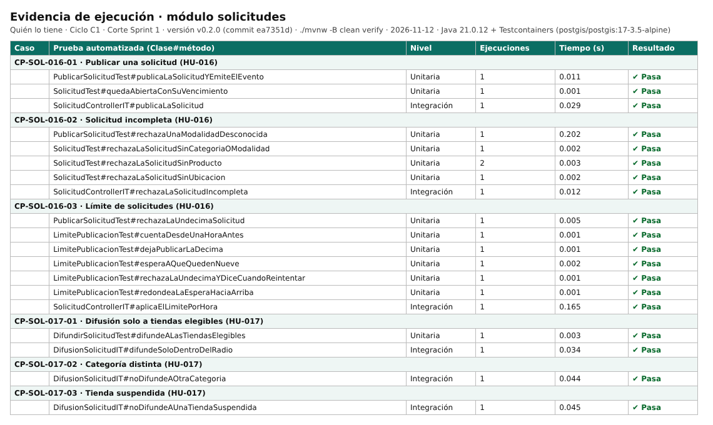

### 6.1 CP-SOL-016-01 — Publicar una solicitud

| Campo | Valor |
|---|---|
| Requisito / criterio | RF-016 · CP-033 del SRS · HU-016 |
| Tipo / nivel / prioridad | Funcional · Unitaria · Alta |
| Prueba automatizada | `PublicarSolicitudTest#publicaLaSolicitudYEmiteElEvento` `SolicitudTest#quedaAbiertaConSuVencimiento` `SolicitudControllerIT#publicaLaSolicitud` |
| Precondición y datos | El cliente está autenticado y compartió su ubicación |
| Pasos ejecutados | `./mvnw -B clean verify` sobre v0.2.0; las pruebas reproducen: 1. Publica "Paracetamol 500 mg, 1 caja" en Farmacias para recoger |
| Resultado esperado | La solicitud queda Abierta con su tiempo de vencimiento |
| Resultado obtenido | 3 de 3 pruebas en verde (3 ejecuciones, 0.04 s); se cumple el resultado esperado. |
| Probador | Yanimar Burbano |
| Resultado | Aprobado |
| Defecto | — |
| Evidencia |  · `../../evidencias/C1/2026-11-12/reportes-junit/` |

### 6.2 CP-SOL-016-02 — Solicitud incompleta

| Campo | Valor |
|---|---|
| Requisito / criterio | RF-016 · CP-034 del SRS · HU-016 |
| Tipo / nivel / prioridad | Funcional · Unitaria · Alta |
| Prueba automatizada | `PublicarSolicitudTest#rechazaUnaModalidadDesconocida` `SolicitudTest#rechazaLaSolicitudSinCategoriaOModalidad` `SolicitudTest#rechazaLaSolicitudSinProducto` `SolicitudTest#rechazaLaSolicitudSinUbicacion` `SolicitudControllerIT#rechazaLaSolicitudIncompleta` |
| Precondición y datos | — |
| Pasos ejecutados | `./mvnw -B clean verify` sobre v0.2.0; las pruebas reproducen: 1. El cliente publica una solicitud sin producto o sin ubicación |
| Resultado esperado | El sistema la rechaza e indica el dato faltante |
| Resultado obtenido | 5 de 5 pruebas en verde (6 ejecuciones, 0.22 s); se cumple el resultado esperado. |
| Probador | Yanimar Burbano |
| Resultado | Aprobado |
| Defecto | — |
| Evidencia |  · `../../evidencias/C1/2026-11-12/reportes-junit/` |

### 6.3 CP-SOL-016-03 — Límite de solicitudes

| Campo | Valor |
|---|---|
| Requisito / criterio | RF-016 · CP-035 del SRS · HU-016 |
| Tipo / nivel / prioridad | Seguridad · Unitaria · Alta |
| Prueba automatizada | `PublicarSolicitudTest#rechazaLaUndecimaSolicitud` `LimitePublicacionTest#cuentaDesdeUnaHoraAntes` `LimitePublicacionTest#dejaPublicarLaDecima` `LimitePublicacionTest#esperaAQueQuedenNueve` `LimitePublicacionTest#rechazaLaUndecimaYDiceCuandoReintentar` `LimitePublicacionTest#redondeaLaEsperaHaciaArriba` `SolicitudControllerIT#aplicaElLimitePorHora` |
| Precondición y datos | Un cliente que publicó 10 solicitudes en la última hora |
| Pasos ejecutados | `./mvnw -B clean verify` sobre v0.2.0; las pruebas reproducen: 1. Intenta publicar otra |
| Resultado esperado | El sistema responde HTTP 429 y le indica cuándo puede volver a intentarlo |
| Resultado obtenido | 7 de 7 pruebas en verde (7 ejecuciones, 0.18 s); se cumple el resultado esperado. |
| Probador | Francisco Castro |
| Resultado | Aprobado |
| Defecto | — |
| Evidencia |  · `../../evidencias/C1/2026-11-12/reportes-junit/` |

### 6.4 CP-SOL-017-01 — Difusión solo a tiendas elegibles

| Campo | Valor |
|---|---|
| Requisito / criterio | RF-017 · CP-036 del SRS · HU-017 |
| Tipo / nivel / prioridad | Funcional · Integración (PostGIS) · Alta |
| Prueba automatizada | `DifundirSolicitudTest#difundeALasTiendasElegibles` `DifusionSolicitudIT#difundeSoloDentroDelRadio` |
| Precondición y datos | Tres farmacias aprobadas y abiertas a 1 km, 2 km y 5 km del cliente |
| Pasos ejecutados | `./mvnw -B clean verify` sobre v0.2.0; las pruebas reproducen: 1. El cliente publica una solicitud de Farmacias |
| Resultado esperado | Solo las farmacias a 1 km y 2 km la reciben |
| Resultado obtenido | 2 de 2 pruebas en verde (2 ejecuciones, 0.04 s); se cumple el resultado esperado. |
| Probador | Yanimar Burbano |
| Resultado | Aprobado |
| Defecto | — |
| Evidencia |  · `../../evidencias/C1/2026-11-12/reportes-junit/` |

### 6.5 CP-SOL-017-02 — Categoría distinta

| Campo | Valor |
|---|---|
| Requisito / criterio | RF-017 · CP-037 del SRS · HU-017 |
| Tipo / nivel / prioridad | Funcional · Integración (PostGIS) · Alta |
| Prueba automatizada | `DifusionSolicitudIT#noDifundeAOtraCategoria` |
| Precondición y datos | Una ferretería abierta a 500 m del cliente |
| Pasos ejecutados | `./mvnw -B clean verify` sobre v0.2.0; las pruebas reproducen: 1. El cliente publica una solicitud de Farmacias |
| Resultado esperado | La ferretería no la recibe |
| Resultado obtenido | 1 de 1 pruebas en verde (1 ejecuciones, 0.04 s); se cumple el resultado esperado. |
| Probador | Yanimar Burbano |
| Resultado | Aprobado |
| Defecto | — |
| Evidencia |  · `../../evidencias/C1/2026-11-12/reportes-junit/` |

### 6.6 CP-SOL-017-03 — Tienda suspendida

| Campo | Valor |
|---|---|
| Requisito / criterio | RF-017 · CP-038 del SRS · HU-017 |
| Tipo / nivel / prioridad | Funcional · Integración (PostGIS) · Alta |
| Prueba automatizada | `DifusionSolicitudIT#noDifundeAUnaTiendaSuspendida` |
| Precondición y datos | Una farmacia suspendida a 1 km del cliente |
| Pasos ejecutados | `./mvnw -B clean verify` sobre v0.2.0; las pruebas reproducen: 1. El cliente publica una solicitud de Farmacias |
| Resultado esperado | La farmacia suspendida no la recibe |
| Resultado obtenido | 1 de 1 pruebas en verde (1 ejecuciones, 0.04 s); se cumple el resultado esperado. |
| Probador | Yanimar Burbano |
| Resultado | Aprobado |
| Defecto | — |
| Evidencia |  · `../../evidencias/C1/2026-11-12/reportes-junit/` |

## 7. Módulo administracion (Yanimar Burbano) — sesión 2026-11-12

Captura de la sesión: 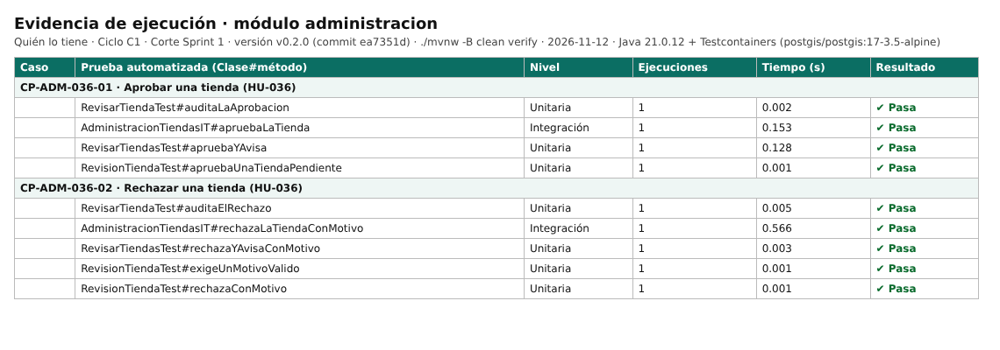

### 7.1 CP-ADM-036-01 — Aprobar una tienda

| Campo | Valor |
|---|---|
| Requisito / criterio | RF-036 · CP-080 del SRS · HU-036 |
| Tipo / nivel / prioridad | Funcional · Unitaria · Alta |
| Prueba automatizada | `RevisarTiendaTest#auditaLaAprobacion` `AdministracionTiendasIT#apruebaLaTienda` `RevisarTiendasTest#apruebaYAvisa` `RevisionTiendaTest#apruebaUnaTiendaPendiente` |
| Precondición y datos | Una tienda Pendiente con documentos válidos |
| Pasos ejecutados | `./mvnw -B clean verify` sobre v0.2.0; las pruebas reproducen: 1. El administrador la aprueba |
| Resultado esperado | La tienda queda Aprobada, es notificada y la acción queda auditada |
| Resultado obtenido | 4 de 4 pruebas en verde (4 ejecuciones, 0.28 s); se cumple el resultado esperado. |
| Probador | Yanimar Burbano |
| Resultado | Aprobado |
| Defecto | — |
| Evidencia |  · `../../evidencias/C1/2026-11-12/reportes-junit/` |

### 7.2 CP-ADM-036-02 — Rechazar una tienda

| Campo | Valor |
|---|---|
| Requisito / criterio | RF-036 · CP-081 del SRS · HU-036 |
| Tipo / nivel / prioridad | Funcional · Unitaria · Alta |
| Prueba automatizada | `RevisarTiendaTest#auditaElRechazo` `AdministracionTiendasIT#rechazaLaTiendaConMotivo` `RevisarTiendasTest#rechazaYAvisaConMotivo` `RevisionTiendaTest#exigeUnMotivoValido` `RevisionTiendaTest#rechazaConMotivo` |
| Precondición y datos | Una tienda Pendiente con documento ilegible |
| Pasos ejecutados | `./mvnw -B clean verify` sobre v0.2.0; las pruebas reproducen: 1. El administrador la rechaza con el motivo "Documento ilegible" |
| Resultado esperado | La tienda queda Rechazada y ve el motivo |
| Resultado obtenido | 5 de 5 pruebas en verde (5 ejecuciones, 0.58 s); se cumple el resultado esperado. |
| Probador | Yanimar Burbano |
| Resultado | Aprobado |
| Defecto | — |
| Evidencia |  · `../../evidencias/C1/2026-11-12/reportes-junit/` |

## 8. Casos no funcionales del ciclo — sesión 2026-11-12

| Caso | Requisito | Probador | Prueba o herramienta | Resultado | Defecto | Medido |
|---|---|---|---|---|---|---|
| NF-SEG-006 | RNF-006 | Francisco Castro | FraseContrasenaTest (14 caracteres se rechaza, 15 se acepta, lista de filtradas) · CargadorLlavesRsaTest#codificaLasFrasesConArgon2id | Aprobado | — | Mínimo 15 caracteres y Argon2id verificados. |
| NF-SEG-011 | RNF-011 | Francisco Castro | CI run #83 · Trivy 0.58.1 | Aprobado | DEF-002 | Trivy: 0 críticas y 0 altas. SpotBugs/FindSecBugs: 0 hallazgos. Falta OWASP Dependency-Check en el pipeline (DEF-002). |
| NF-SEG-014 | RNF-014 | Francisco Castro | RegistrarClienteTest#guardaLaAutorizacionConVersionYFecha · AutorizacionDatosTest · AutenticacionControllerIT#guardaLaAutorizacionDeDatos | Aprobado | — | Versión y fecha de la política guardadas en el 100 % de los registros probados. |
| NF-FIA-016 | RNF-016 | Yanimar Burbano | RevisionTiendaTest#rechazaTransicionesInvalidas (3 estados) | Aprobado | DEF-004 | Corte S1: máquina de la tienda, 0 transiciones inválidas aceptadas. Solicitud (HU-021) y orden (HU-027) se prueban al cierre del C1. Falta la etiqueta (DEF-004). |
| NF-ESC-021 | RNF-021 | Yanimar Burbano | ModulosTest#losModulosRespetanSusFronteras | Aprobado | — | Spring Modulith verify(): 0 violaciones. |
| NF-MAN-022 | RNF-022 | Yanimar Burbano | jacoco:check · jacoco.csv | Aprobado | DEF-003 | 97,2 % de líneas en domain + application; el módulo más bajo es identidad con 94,1 %. La regla automática es global (DEF-003). |
| NF-MAN-023 | RNF-023 | Yanimar Burbano | ReglasDeArquitecturaTest (6 reglas ArchUnit) | Aprobado | — | 0 violaciones. |
| NF-POR-030 | RNF-030 | Francisco Castro | CI run #83 · Gitleaks 8.21.2 | Aprobado | — | 33 commits revisados, «no leaks found». |

Evidencia:  · [`ci-seguridad-run83.txt`](../../evidencias/C1/2026-11-12/ci-seguridad-run83.txt)

## 9. Evidencia de la interfaz — sesión exploratoria 2026-11-12

La PWA se levantó en local con el backend v0.2.0 y se recorrieron 45 vistas y estados en tamaño de celular. El detalle de cada vista está en [EXPLORATORIA-20261112-yanimar.md](EXPLORATORIA-20261112-yanimar.md) y las 45 capturas en `evidencias/C1/2026-11-12/frontend/`. Estas son las capturas que respaldan cada caso del Sprint 1:

**Cuenta de cliente creada (CP-IDE-001-01)**

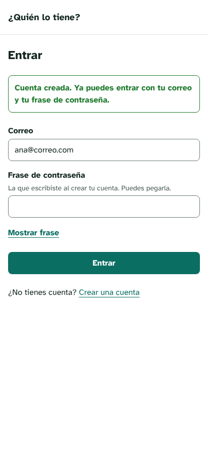

**Frase filtrada rechazada (CP-IDE-001-03)**

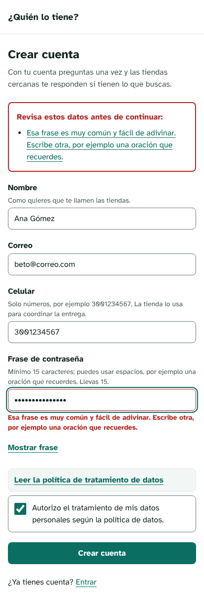

**Credenciales incorrectas (CP-IDE-003-02)**

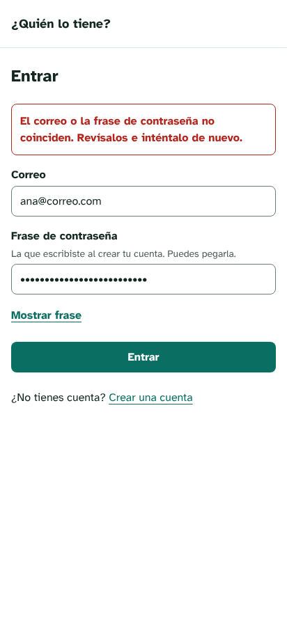

**Segundo factor inválido (CP-IDE-004-02)**

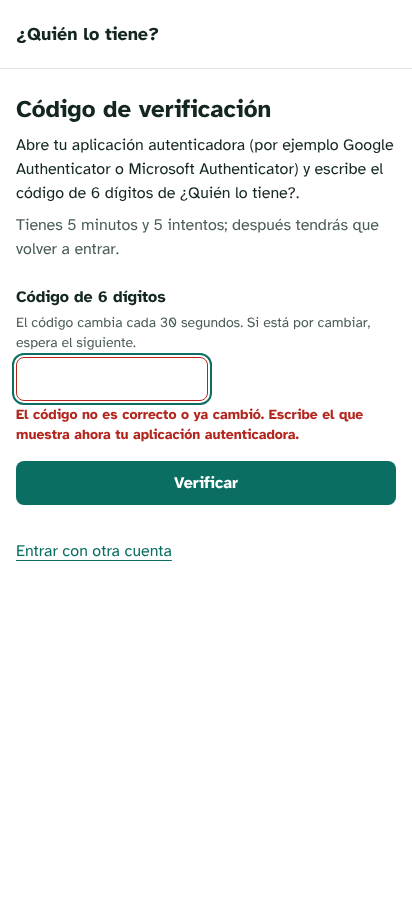

**Dirección guardada (CP-CLI-007-01)**

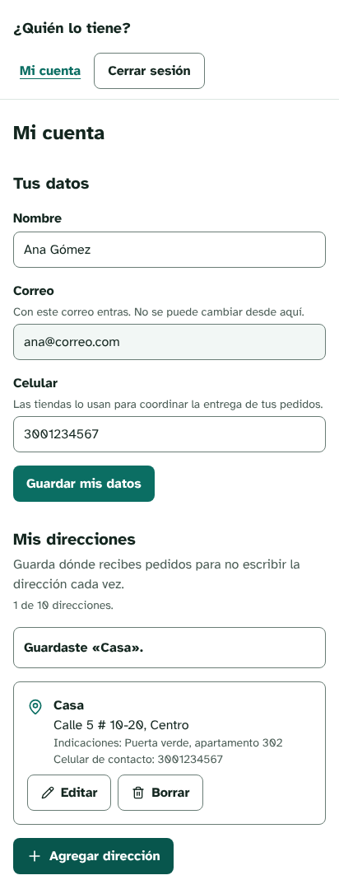

**Tienda en revisión (CP-TIE-002-01)**

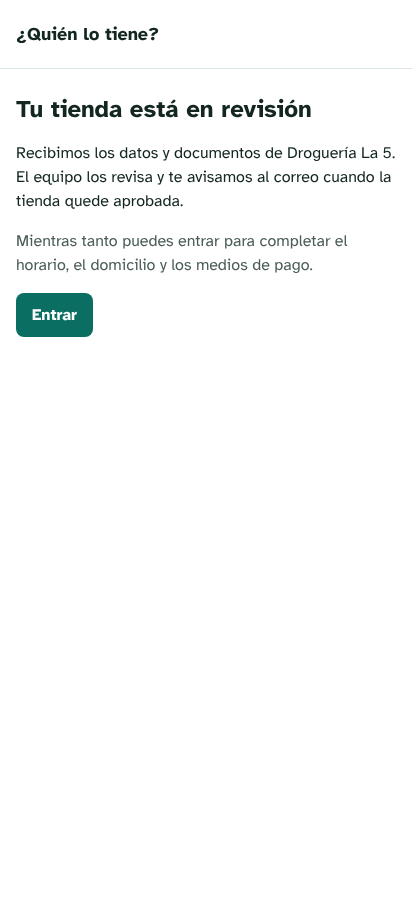

**Registro sin documentos (CP-TIE-002-02)**

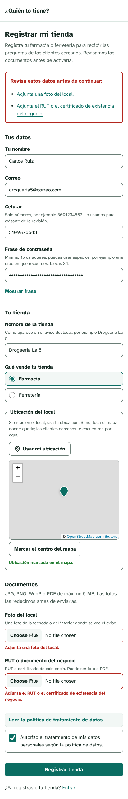

**Tienda aprobada (CP-ADM-036-01)**

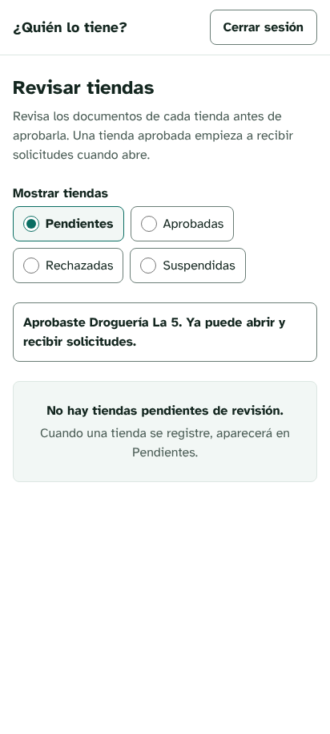

**Tienda rechazada con motivo (CP-ADM-036-02)**

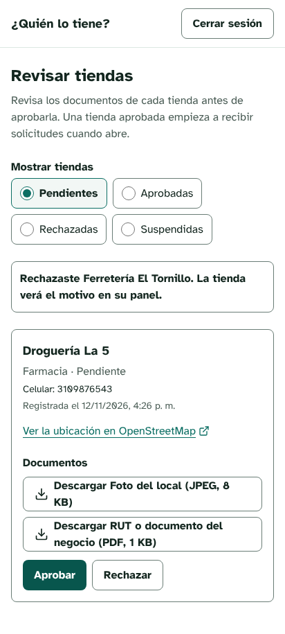

**Perfil y horario (CP-TIE-009-02)**

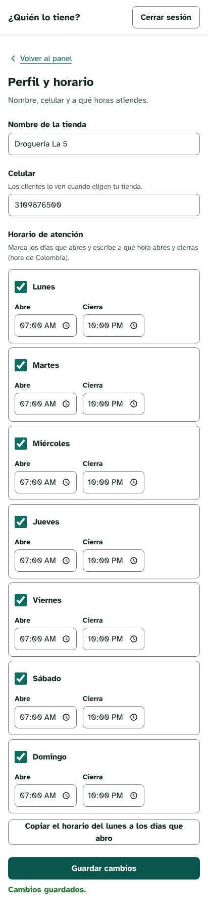

**Tarifa fija de domicilio (CP-TIE-010-01)**

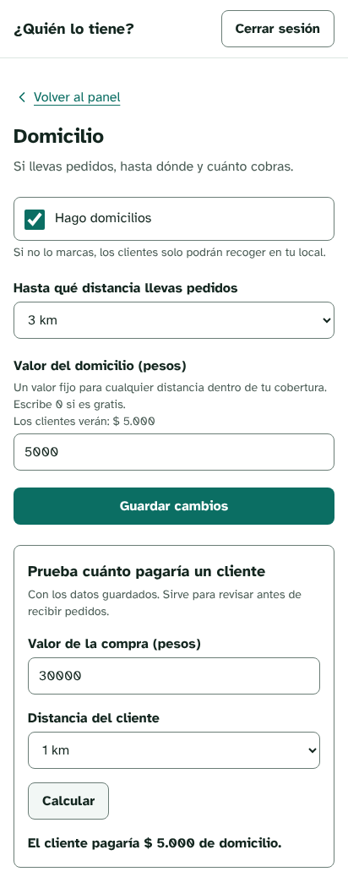

**Medios de pago activos (CP-TIE-012-01)**

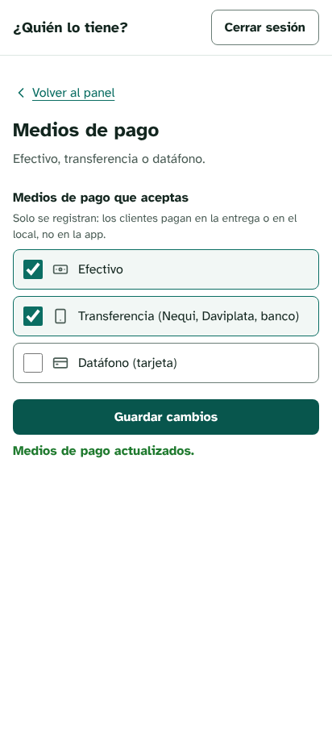

**Tienda abierta (CP-TIE-013-02)**

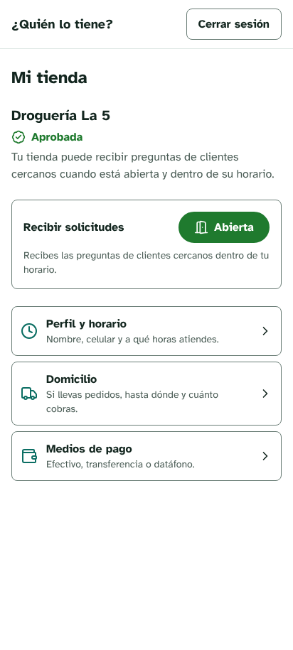

**Solicitud que llega a 1 tienda (CP-SOL-016-01, CP-SOL-017-01)**

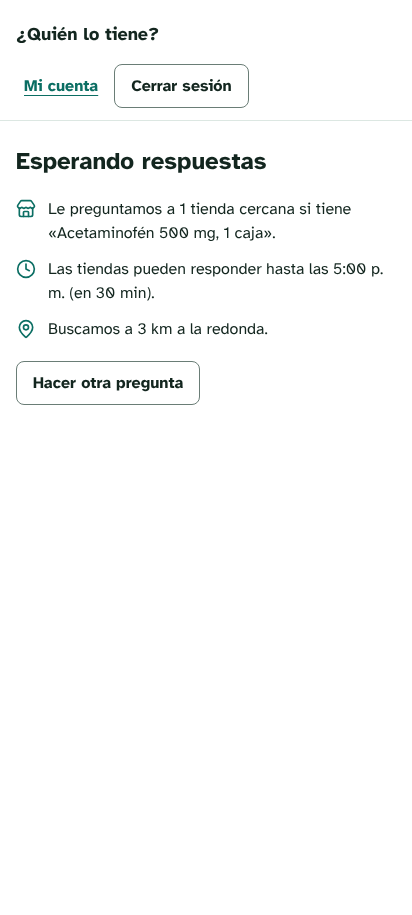

**Tienda cerrada no la recibe (CP-TIE-013-01)**

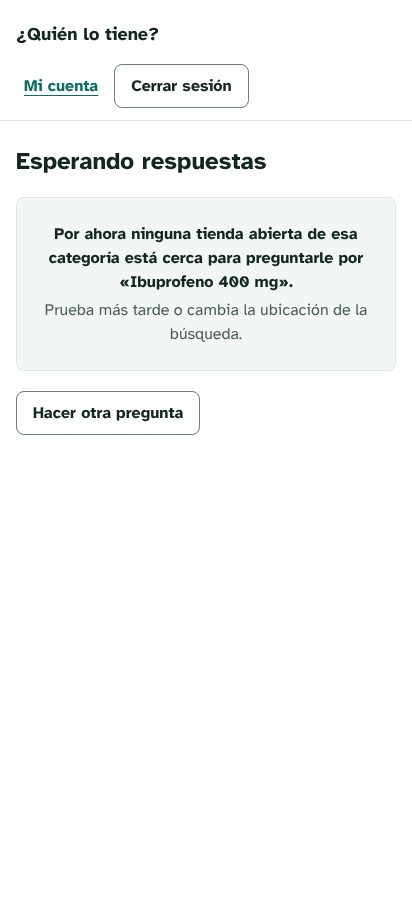

**Solicitud incompleta (CP-SOL-016-02, DEF-005)**

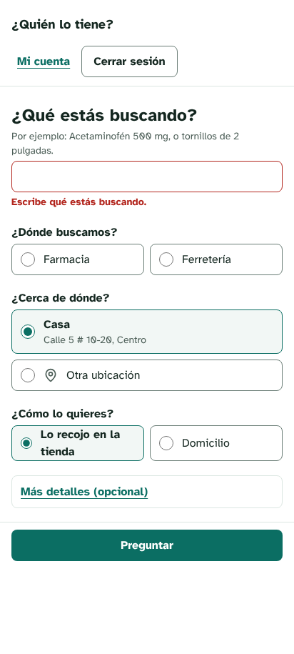

## Historial del documento

| Versión | Fecha | Autor | Cambio |
|---|---|---|---|
| — | 12/11/2026 | Daniel Montenegro Almendra (@Daniel0442123) | docs(pruebas): corte del Sprint 1 del ciclo C1 sobre v0.2.0 (#32) |
| 1.0 | 13/11/2026 | Daniel Montenegro Almendra (@Daniel0442123) | Se agrega el control del documento (encabezado e historial). Las filas anteriores se reconstruyeron desde Git; esos cambios no tenían número de versión (SC-009) |
